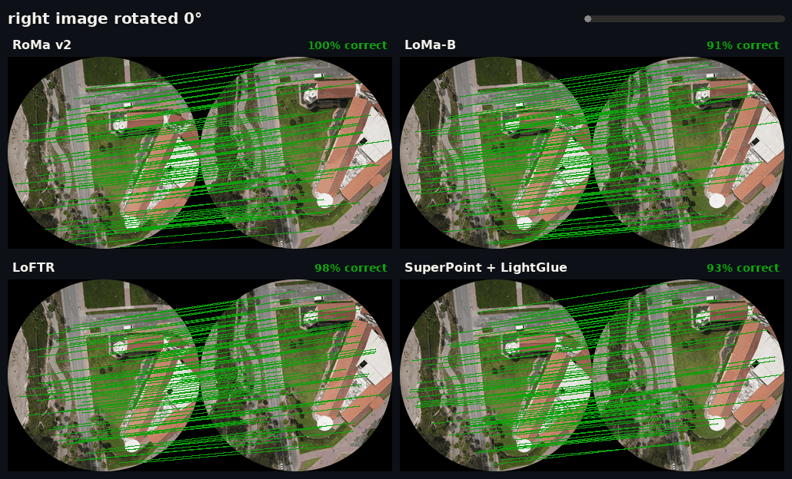
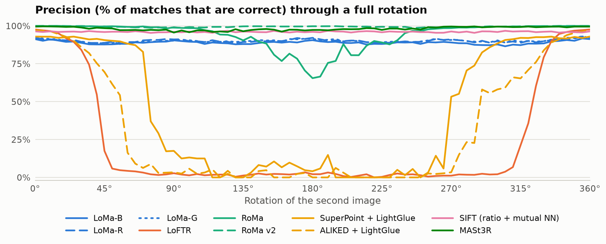

<div align="center">

<h1>🌀 Matchers Under Rotation</h1>

<p><b>Spin a drone photo 360°. Watch ten famous point matchers either keep up — or fall apart.</b></p>

<a href="https://chandrakanth-gudavalli.github.io/matcher-rotation/"></a>


<br><br>

<a href="https://chandrakanth-gudavalli.github.io/matcher-rotation/">
  
</a>

<sub>🟩 match agrees with the true geometry &nbsp;·&nbsp; 🟥 match is wrong &nbsp;·&nbsp; <b><a href="https://chandrakanth-gudavalli.github.io/matcher-rotation/">try every method and angle yourself →</a></b></sub>

</div>

---

## 🏆 The leaderboard

Precision = share of returned matches that are geometrically correct, measured at every 5° of rotation.

| | Method | Type | Worst precision | Mean precision | ≥ 50% correct for | Time / pair* |
|:-:|---|---|--:|--:|:-:|--:|
| 🥇 | **[RoMa v2](https://github.com/Parskatt/RoMaV2)** | dense | **98.6%** | 99.5% | 🟢 360° | 11.4 s |
| 🥈 | **[MASt3R](https://github.com/naver/mast3r)** | dense | **95.6%** | 98.2% | 🟢 360° | 1.2 s |
| 🥉 | **[SIFT](https://docs.opencv.org/4.x/da/df5/tutorial_py_sift_intro.html)** (ratio + mutual NN) | sparse | **95.4%** | 96.1% | 🟢 360° | 1.0 s |
| 4 | [LoMa-G](https://github.com/davnords/LoMa) | sparse | 88.4% | 90.2% | 🟢 360° | 14.6 s |
| 5 | [LoMa-R](https://github.com/davnords/LoMa) | sparse | 88.0% | 90.1% | 🟢 360° | 12.7 s |
| 6 | [LoMa-B](https://github.com/davnords/LoMa) | sparse | 86.5% | 88.9% | 🟢 360° | 12.6 s |
| 7 | [RoMa](https://github.com/Parskatt/RoMa) | dense | 65.5% <sub>@ 180°</sub> | 93.9% | 🟢 360° | 7.5 s |
| 8 | [SuperPoint + LightGlue](https://github.com/cvg/LightGlue) | sparse | 0.0% | 43.8% | 🟠 165° | 0.8 s |
| 9 | [ALIKED + LightGlue](https://github.com/cvg/LightGlue) | sparse | 0.0% | 30.9% | 🔴 130° | 0.6 s |
| 10 | [LoFTR](https://github.com/zju3dv/LoFTR) | semi-dense | 0.0% | 22.0% | 🔴 80° | 0.5 s |

<sub>* On a 2015 GTX TITAN X — compare methods with each other, not with your modern GPU.</sub>

<picture>
  <source media="(prefers-color-scheme: dark)" srcset="assets/readme/precision_dark.png">
  
</picture>

## 💡 What jumps out

- **Three cliffs.** LoFTR is near-perfect up to ~30° and gone by 50°. ALIKED + LightGlue fades from ~40°, SuperPoint + LightGlue holds out until ~75° — then all three drop to ≈0% until the image comes back around.
- **Old-school still slaps.** SIFT, from 2004, is rotation invariant by design and stays above 95% at every angle.
- **Foundation-model matchers shrug it off.** RoMa v2 and MASt3R barely notice the rotation at all.
- **RoMa's upside-down wobble.** The original RoMa dips to 65% around 180°; its successor RoMa v2 fixes it.
- **All of LoMa holds up** — not only the rotation-augmented LoMa-R — at least on this textured top-down scene.

## 🔬 How it works

```
  drone frame A ──► circular crop ──────────────────────────┐
                                                            ├──► matcher ──► matches
  drone frame B ──► circular crop ──► rotate 0°…355° ───────┘                  │
                                                                               ▼
        undo the known rotation ──► epipolar (Sampson) error < 3 px ?  ──► ✓ / ✗
```

1. **Same input for everyone.** Two overlapping frames from a fixed-wing drone survey are cropped to circles (so rotating never pushes content out of frame) and resized to 2048 px. The right image is rotated in 5° steps — 72 versions.
2. **Default settings.** Every matcher runs with its published weights and its own internal resizing.
3. **Exact ground truth from the rotation itself.** Because the rotation is known, each match can be mapped back to the unrotated image and checked against a fundamental matrix fitted (MAGSAC) on the pooled 0° matches of all methods. An epipolar check, not a homography, because buildings and trees have real depth.
4. **No free lunch from black corners.** Matches with either end outside the image circle are discarded for every method.

## 🧰 Reproduce it

<details>
<summary><b>Setup and commands</b> (three conda envs, ~1 hour on two old GPUs)</summary>

Each matcher family runs in its own environment (they have conflicting dependencies); all were
tested with PyTorch 2.14 + CUDA 12.6.

```bash
# third-party code
mkdir -p third_party && cd third_party
git clone https://github.com/davnords/LoMa.git
git clone https://github.com/cvg/LightGlue.git
git clone https://github.com/Parskatt/RoMa.git
git clone https://github.com/Parskatt/RoMaV2.git
git clone --recursive https://github.com/naver/mast3r.git
cd ..

# env "loma": LoMa, LightGlue (SuperPoint, ALIKED), LoFTR (kornia), SIFT (opencv)
pip install -e third_party/LoMa -e third_party/LightGlue
# env "romas": RoMa + RoMa v2 (uninstall fused-local-corr if it has no build for your torch)
pip install -e third_party/RoMa -e third_party/RoMaV2
# env "mast3r"
pip install -r third_party/mast3r/requirements.txt -r third_party/mast3r/dust3r/requirements.txt

python bench/prepare.py <image_A> <image_B>          # circular crops + 72 rotated copies
python bench/run_sweep.py loma-b                     # repeat per matcher, in its env
PYTHONPATH=third_party/mast3r python bench/run_sweep.py mast3r
python bench/score_export.py                         # writes assets/data.json
python bench/make_readme_media.py                    # README GIF + charts
python -m http.server                                # open http://localhost:8000
```

Without the fused correlation kernel, RoMa v2's native fallback needs more memory than a
12 GB GPU has at its default "precise" setting; this run used a local patch that computes
the local correlation in row chunks (same result, lower peak memory).

</details>

| File | What it does |
|---|---|
| [`bench/matchers.py`](bench/matchers.py) | One uniform wrapper per matcher: `(image_A, image_B) → (points_A, points_B, confidence)` |
| [`bench/prepare.py`](bench/prepare.py) | Circular crops and the 72 rotated copies |
| [`bench/run_sweep.py`](bench/run_sweep.py) | Runs one matcher over every angle, with timings |
| [`bench/score_export.py`](bench/score_export.py) | Shared ground truth, scoring, and the page's `data.json` |
| [`index.html`](index.html) | The interactive page — no build step, no dependencies |

## ⚠️ Fine print

One image pair is an anecdote, not a benchmark. Easy, heavily textured top-down scenes flatter
every method, and sparse methods' match counts aren't directly comparable with dense methods'
sampled budgets — precision is the fairer lens.

## 🙏 Credits

Built on the excellent open-source work behind
[LoMa](https://github.com/davnords/LoMa),
[LoFTR](https://github.com/zju3dv/LoFTR) (via [kornia](https://github.com/kornia/kornia)),
[RoMa](https://github.com/Parskatt/RoMa),
[RoMa v2](https://github.com/Parskatt/RoMaV2),
[LightGlue](https://github.com/cvg/LightGlue),
[MASt3R](https://github.com/naver/mast3r) and
[OpenCV](https://opencv.org/).
